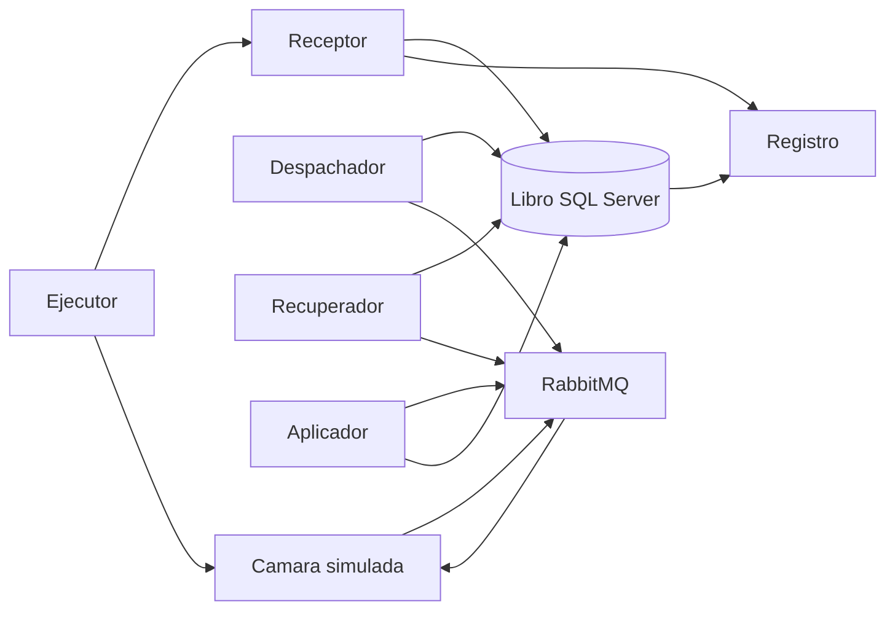
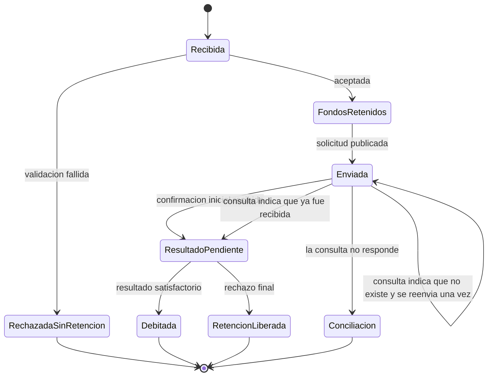

# E7c. Diseño del artefacto

## Composición

El artefacto tiene tres partes. El modelo describe estados, mensajes y transiciones. La instancia los ejecuta en .NET Core, con SQL Server, RabbitMQ y Polly. Los principios de selección no se declaran todavía como resultado: se formularán en E10 solo si la evaluación los sostiene. La instancia es el vehículo de esa evidencia.

## Componentes

La instancia tiene tres procesos en la misma máquina.

| Componente | Responsabilidad |
|:--|:--|
| Receptor | Recibe la solicitud sintética, valida cuenta y fondos, y aplica la política de cierre |
| Libro | Conserva transferencia, retención, trabajo pendiente, identidades procesadas y efectos |
| Despachador | Publica el mensaje inicial solo cuando la cámara está abierta y el trabajo ya está confirmado en SQL Server |
| Recuperador | Espera 10 segundos sin confirmación inicial, consulta y decide esperar, reenviar una vez o conciliar |
| Aplicador | Recibe el resultado final y debita o libera la retención |
| Registro | Guarda marcas de tiempo, estados, consultas, reenvíos y efectos de cada ejecución |
| Cámara simulada | Persiste la solicitud recibida, responde la consulta, emite la confirmación inicial y el resultado final |
| Ejecutor | Reinicia el estado, fija la configuración, inyecta un fallo y recoge los indicadores |

## Mensajes

Todos los intercambios de la instancia usan RabbitMQ. No se reproduce el catálogo propietario del antecedente. Los nombres 1A y 1B conservan solo la función ya delimitada.

| Mensaje | Función | Identidad |
|:--|:--|:--|
| Solicitud inicial | Pide a la cámara que reciba la transferencia | Identidad de transferencia, creada por el origen |
| Confirmación inicial | Indica que la cámara recibió esa solicitud | La misma identidad |
| Consulta | Pregunta si la cámara conoce esa identidad | La misma identidad |
| Respuesta de consulta | Recibida, inexistente o sin respuesta | La misma identidad |
| Resultado final | Comunica débito procedente o rechazo final | La misma identidad |
| Acuse del resultado | Confirma que el origen recibió el resultado | La misma identidad |

La confirmación del publicador de RabbitMQ no sustituye la confirmación inicial. La primera acredita que el intermediario aceptó el mensaje. La segunda acredita que la cámara lo procesó. El escenario de pérdida se construye precisamente cuando la primera existe y la segunda no llega (RabbitMQ, s. f.-a; principio 7 de E4).

Hay cuatro colas: solicitudes, confirmaciones, consultas y resultados. El resultado se entrega al menos una vez. La cámara puede publicarlo dos veces para el escenario de duplicado.

## Modelo de estados

Durante el cierre, la propuesta permanece en fondos retenidos, con el trabajo pendiente grabado, y no pasa a enviada. El control de ese escenario pasa de recibida a rechazada sin retención y no conserva la solicitud.

## Libro

| Registro | Contenido mínimo | Restricción |
|:--|:--|:--|
| Transferencia | Identidad, cuenta, monto, estado, marcas de tiempo | Identidad única |
| Retención | Identidad, monto, vigente o liberada | Como máximo una retención vigente por identidad |
| Trabajo pendiente | Identidad, carga de la solicitud, pendiente o publicado | Se escribe en la misma transacción que la transferencia aceptada |
| Identidad procesada | Identidad del resultado ya aplicado | Clave única |
| Efecto | Identidad, débito o liberación, monto | La propuesta impide dos efectos definitivos |
| Ventana | Cámara abierta o cerrada, momento de la reapertura | La controla el ejecutor |
| Ejecución | Variante, escenario, repetición e indicadores | Una fila por ejecución |

La identidad es un identificador generado por el origen al aceptar. No se usa el identificador interno de RabbitMQ, porque una republicación puede cambiarlo.

## Decisiones de diseño

| Decisión | Alternativa considerada | Justificación |
|:--|:--|:--|
| Tres procesos: origen, cámara y ejecutor | Un solo proceso con objetos en memoria | La pérdida de confirmación y la caída local exigen que el estado de la cámara sobreviva al origen |
| Solicitud, confirmación, consulta y resultado por RabbitMQ | Solicitud por HTTP y solo el resultado por cola | Mantiene el vehículo decidido en E7a y permite usar la confirmación del publicador |
| Confirmar al publicador y, además, esperar la confirmación inicial | Tratar la confirmación del publicador como 1B | Esa equivalencia impediría el fallo en que la cámara ya procesó la solicitud (Kleppmann y Riccomini, 2026) |
| Escribir transferencia, retención y trabajo pendiente en una transacción | Publicar y después grabar | Cubre RF-12. Si el proceso cae antes de confirmar, la solicitud no queda aceptada |
| Sondear el trabajo pendiente cada un segundo | Publicar dentro de la transacción SQL | El sondeo deja la publicación fuera de la transacción y cabe en los 10 segundos de RF-03 |
| Insertar la identidad procesada y aplicar el efecto en una transacción | Comprobar la existencia y después debitar | La comprobación separada es el control. La propuesta cubre RF-11 (Ding et al., 2023) |
| Consultar una vez, a los 10 segundos | Reintentar el envío con Polly al perderse la confirmación | Polly no distingue si la cámara procesó la solicitud (RC-05) |
| Reenviar una sola vez y solo si la consulta dice que no existe | Reenviar mientras no llegue un resultado | Limita el segundo efecto y cumple RF-08 y RF-09 |
| Pasar a conciliación si la consulta no responde | Liberar la retención o debitar por tiempo agotado | Conserva identidad, monto y retención, como exige RF-10 |
| En cada ejecución cambiar solo el mecanismo del escenario | Comparar una arquitectura completa con otra carente de todos los mecanismos | Los otros tres mecanismos quedan en la respuesta de la propuesta, de modo que el indicador pueda atribuirse al contraste (E5) |
| Inyectar la caída en un punto nombrado y reiniciar el proceso | Provocar una caída en un instante aleatorio | Hace repetibles las 30 ejecuciones. El estado SQL permanece y el proceso vuelve a arrancar |

El punto de inyección del fallo local ocurre después de aceptar y antes de publicar. En la propuesta, la transacción del trabajo pendiente ya está confirmada. En el control de publicación directa, el estado local cambió y la publicación todavía no ocurrió. El ejecutor detiene el origen y lo inicia de nuevo.

## Configuración de los contrastes

| Escenario | Parámetro | Control | Propuesta |
|:--|:--|:--|:--|
| Cierre | Política de aceptación | Rechazar | Aceptar y diferir |
| Resultado duplicado | Aplicación del efecto | Comprobación separada | Transacción única |
| Confirmación perdida | Recuperación | Reenvío inmediato | Consulta previa |
| Fallo local | Publicación | Directa | Trabajo pendiente |

Los parámetros que no pertenecen al escenario permanecen en la columna de propuesta. El simulador, las cuentas y el registro no cambian (RF-15).

## Comportamiento por requisito

| Requisito | Componente | Decisión que lo satisface |
|:--|:--|:--|
| RF-01 | Receptor y libro | Durante el cierre graba fondos retenidos y trabajo pendiente, y el despachador no publica |
| RF-02 | Receptor | Responde aceptación pendiente y el ejecutor no genera otra solicitud del usuario |
| RF-03 | Despachador | El sondeo de un segundo inicia la publicación dentro de los 10 segundos posteriores a la reapertura |
| RF-04 | Receptor | La validación fallida termina en rechazada sin retención |
| RF-05 | Aplicador | El rechazo final libera la retención en la misma transacción del resultado |
| RF-06 | Libro y mensajes | Una identidad creada al aceptar acompaña solicitud, consulta, reenvío y resultado |
| RF-07 | Recuperador | A los 10 segundos sin confirmación inicial publica una consulta |
| RF-08 | Recuperador | Si la respuesta es «recibida», pasa a resultado pendiente y no reenvía |
| RF-09 | Recuperador | Si la respuesta es «inexistente», publica una sola vez la misma solicitud |
| RF-10 | Recuperador y libro | Si no hay respuesta, graba conciliación y no debita, no libera ni reenvía |
| RF-11 | Aplicador | La identidad procesada y el efecto se confirman juntos |
| RF-12 | Receptor y despachador | El trabajo pendiente se confirma antes de publicar; la publicación espera la confirmación del publicador |
| RF-13 | Libro | Los únicos cierres de una solicitud aceptada son debitada, retención liberada y conciliación |
| RF-14 | Libro | Los ocho estados están representados y cada transición queda registrada |
| RF-15 | Ejecutor | Un parámetro cambia el mecanismo del escenario |
| RF-16 | Receptor | La medición sin fallos compara la aceptación durable con la aceptación que no deja trabajo pendiente |
| RC-01 | Cámara simulada | La consulta responde por identidad y un reenvío con esa identidad no crea otra transferencia |
| RC-02 | Ejecutor | Cuentas, montos e identidades son sintéticos |
| RC-03 | Ejecutor | Solo activa los cuatro escenarios |
| RC-04 | Instancia completa | SQL Server, RabbitMQ, Polly y código propio; sin plataforma durable |
| RC-05 | Despachador | Polly solo repite una publicación ante un fallo transitorio del intermediario, con la misma identidad |

## Supuestos que condicionan el diseño

La cámara simulada permanece disponible para la consulta, salvo cuando el escenario apaga esa respuesta. Reconoce la identidad repetida. El reloj de cierre lo controla el ejecutor, no un calendario real. La caída se produce en el punto nombrado, no en un fallo eléctrico arbitrario. Estos supuestos son condiciones de contorno: si una cámara real no consulta o no reconoce la identidad, la instancia solo puede llegar a conciliación.

## Cierre de E7c

El diseño cubre los 21 requisitos, nombra componentes y relaciones, justifica las decisiones frente a una alternativa y se apoya en E4 y E7a. El 13 de octubre de 2026 el tesista confirmó tres elecciones estructurales:

1. El origen y la cámara simulada son procesos distintos. El ejecutor es el tercer proceso.
2. La solicitud, la confirmación inicial, la consulta y el resultado viajan por RabbitMQ. La confirmación del publicador no sustituye a la confirmación inicial.
3. En cada ejecución cambia solo el mecanismo del escenario. Los otros tres permanecen en la respuesta de la propuesta.

E7c queda cerrada.
