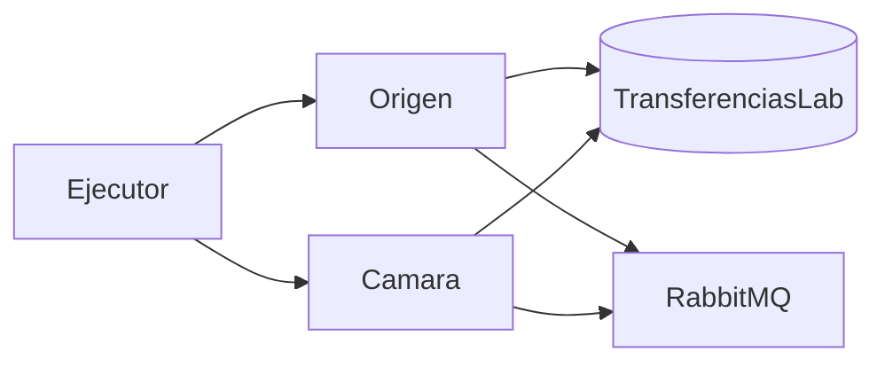

# E7f. Ficha del artefacto

## Identificación

| Campo | Valor |
|:--|:--|
| Nombre | Instancia experimental de transferencias salientes con mensajería durable |
| Tipología | Composición: modelo arquitectónico, instancia mínima y vehículo de los principios de diseño |
| Ubicación | `artefacto/` |
| Fecha de esta ficha | 22 de octubre de 2026 |
| Problema que aborda | Conservar una solicitud aceptada durante una indisponibilidad temporal y no aplicar el efecto de negocio más de una vez cuando el resultado puede duplicarse |
| Ejemplar | Transferencia saliente de 25.00 desde la cuenta sintética `C-100`, saldo inicial 1 000.00 |

La contribución no es esta instancia. La instancia es el vehículo con el que se compararon las respuestas. Otro investigador puede reconstruir el experimento desde esta ficha y desde el código de `artefacto/`, sin el catálogo histórico de mensajes de la entidad.

## Qué debe poder reproducirse

1. Aceptar una solicitud, retener fondos y dejar el mensaje en la misma transacción.
2. Publicar solo después de confirmar esa transacción y distinguir la confirmación del publicador de la confirmación inicial.
3. Ante una caída entre la aceptación y la publicación, retomar el despacho si hay trabajo pendiente, o pasar a conciliación si la publicación era solo de memoria.
4. Durante una ventana cerrada, rechazar sin retener, o aceptar, retener y despachar como máximo 10 segundos después de la reapertura.
5. Ante dos resultados de la misma identidad, dejar un solo efecto si la reserva y el efecto van en la misma transacción.
6. Si no llega la confirmación inicial, consultar a los 10 segundos y no reenviar cuando la cámara ya tiene la solicitud. El otro brazo reenvía la misma identidad al segundo.

## Componentes

La solución `artefacto/Transferencias.sln` tiene cuatro proyectos para `net10.0`.

| Proyecto | Papel |
|:--|:--|
| `Transferencias.Compartido` | Estados, tipos de mensaje, nombres de cola y el cliente del intermediario |
| `Transferencias.Origen` | Acepta, retiene, publica, consulta, aplica el resultado y concilia el limbo al arrancar |
| `Transferencias.Camara` | Persiste la solicitud por identidad, emite la confirmación inicial y el resultado, y responde la consulta |
| `Transferencias.Ejecutor` | Crea el libro, reinicia los datos, arranca los procesos y comprueba cada brazo |

El ejecutor no es parte del flujo de negocio. Inserta la solicitud sintética en `SolicitudEntrante` y lee el libro para decidir si el brazo se comportó como estaba previsto.



Origen y cámara no comparten tablas de negocio. Comparten la instancia local de SQL Server. La cámara escribe solo `CamaraSolicitud`.

## Intermediario

RabbitMQ en `localhost`, puerto 5672, usuario y clave `guest`, que es la cuenta predeterminada y solo atiende conexiones locales. El cliente es `RabbitMQ.Client` 6.8.1. Cada cola se declara durable. Cada mensaje se publica como persistente y el canal espera la confirmación del publicador hasta 5 segundos. Esa confirmación no es la confirmación inicial de la cámara.

| Cola | Uso en la instancia evaluada |
|:--|:--|
| `transferencias.solicitudes` | La solicitud 1A, también en el reenvío |
| `transferencias.confirmaciones` | La confirmación inicial |
| `transferencias.consultas` | La consulta por identidad |
| `transferencias.respuestas-consulta` | `ConsultaRecibida` o `ConsultaInexistente` |
| `transferencias.resultados` | El resultado satisfactorio |
| `transferencias.acuses` | Se publica al aplicar el resultado atómico. Nadie lo consume |

El consumo es un `BasicGet` en un ciclo de 200 ms, no un consumidor asíncrono permanente.

## Libro

El ejecutor crea o actualiza `TransferenciasLab` con `artefacto/sql/001_libro.sql`, copiado a la salida del proyecto. La autenticación es de Windows, con `TrustServerCertificate=true`.

| Tabla | Función |
|:--|:--|
| `Cuenta` | Saldo. La semilla de cada pasada es `C-100` = 1 000.00 |
| `Transferencia` | Identidad, monto, estado, confirmación del publicador, confirmación inicial, duración de la aceptación, reenvíos, consultas y momento de la consulta |
| `Retencion` | Monto retenido y si sigue vigente |
| `TrabajoPendiente` | Carga JSON del mensaje y estado `Pendiente` o `Publicado` |
| `IdentidadProcesada` | Reserva de la identidad. La clave impide una segunda reserva |
| `Efecto` | Fila de débito. La identidad de transferencia no es única en esta tabla |
| `Ventana` | Una fila: abierta o cerrada, y el momento de reapertura |
| `SolicitudEntrante` | Buzón del ejecutor. No es una cola de la cámara |
| `CamaraSolicitud` | Lo que la cámara ya recibió, con la identidad como clave |
| `Ejecucion` | Prevista en el esquema. El ejecutor la vacía y no la usa. El registro sumativo es el archivo CSV |

La aceptación con fondos suficientes descuenta el saldo y deja la retención vigente. El débito posterior no vuelve a descontar el saldo: pone la retención en no vigente e inserta la fila de efecto. Un rechazo inicial no retiene y no descuenta.

## Estados que el código alcanza

Recibida, rechazada sin retención, fondos retenidos, enviada, resultado pendiente, debitada y conciliación. El diagrama de E7c también preveía retención liberada por un rechazo final. La cámara evaluada solo emite resultado satisfactorio, así que ese estado no se alcanzó en las 240 pasadas.

Al arrancar, el origen marca conciliación cuando encuentra fondos retenidos, sin confirmación del publicador y sin fila de trabajo pendiente. No debita, no libera y no reenvía. Si existe trabajo pendiente, no la absorbe.

## Configuración de un solo mecanismo

Si la variable no está definida, el proceso queda del lado de la propuesta.

| Variable | Propuesta | Control | Dónde |
|:--|:--|:--|:--|
| `PUBLICACION` | `TrabajoPendiente` | `Directa` | Origen |
| `CIERRE` | aceptar y diferir | `Rechazar` | Origen |
| `EFECTO` | transacción única | `ComprobacionSeparada` | Origen |
| `RECUPERACION` | consulta a los 10 segundos | `ReenvioInmediato` | Origen |
| `CAMARA_PERDER_1B` | | `1` omite la confirmación inicial | Cámara |
| `CAMARA_DUPLICAR_RESULTADO` | | `1` publica el resultado dos veces | Cámara |
| `ORIGEN_DETENER_TRAS_ACEPTAR` | | `1` sale después de confirmar y antes de publicar | Origen |

La publicación directa guarda el mensaje en una lista de memoria. Al salir el proceso, esa lista desaparece. El trabajo pendiente queda en la misma transacción que la transferencia y la retención, y el despachador lo publica después de confirmar.

La comprobación separada lee si la identidad ya fue reservada, espera 400 ms y después inserta el efecto. La reserva de la identidad va en una sentencia posterior. Esa espera existe para que dos consumidores puedan ver la identidad libre. La respuesta atómica inserta la reserva y el efecto en la misma transacción; una clave duplicada revierte las dos.

La consulta espera a que hayan pasado 10 segundos desde la confirmación del publicador y solo si la confirmación inicial sigue vacía. Si la cámara responde que ya recibió la solicitud, el origen no reenvía. El reenvío inmediato espera 1 segundo y republica la misma identidad.

## Versiones

| Versión | Qué quedó | Comando |
|:--|:--|:--|
| V0 | Camino sin fallos y reinicio con trabajo pendiente | `verificar-v0` |
| V1 | Contraste del fallo local, cinco pasadas internas por brazo | `verificar-v1` |
| V2 | Conciliación al arrancar cuando no hay despacho recuperable | `verificar-v2` |
| V3 | Ocho brazos y 30 repeticiones | `verificar-sumativa` |

`verificar-contrastes` recorre una pasada de los seis brazos de cierre, duplicado y confirmación perdida. No sustituye a las 240. Las cinco pasadas de V1 y de V2 tampoco entran en esas 240.

## Cómo ejecutarlo

Hace falta el SDK de .NET 10, SQL Server local con autenticación de Windows y el servicio de RabbitMQ en el puerto 5672. En la máquina de la evaluación se usaron el SDK 10.0.401, SQL Server 2022 Developer 16.0.1210.3, Erlang/OTP 28.5 y RabbitMQ 4.3.6.

Desde `artefacto/`:

```text
dotnet build Transferencias.sln
dotnet exec src\Transferencias.Ejecutor\bin\Debug\net10.0\Transferencias.Ejecutor.dll verificar-v0
dotnet exec src\Transferencias.Ejecutor\bin\Debug\net10.0\Transferencias.Ejecutor.dll verificar-sumativa
```

El segundo comando reescribe `artefacto/resultados/sumativa.csv`. Cada pasada vacía las cinco colas originales más la de respuestas y deja la cuenta en 1 000.00. El código de salida 0 significa que cada aserción del comando se cumplió.

## Decisiones que no se reabren

Se descartaron MassTransit, NServiceBus, CAP, Wolverine, Temporal, Dapr y Durable Task como vehículo. La comparación vive en el mismo programa y cambia por configuración. No hay interfaz gráfica, contenedores, mapeo ejecutable a AWS, criptografía propia ni acreditación entrante. La identidad es un GUID creado por el origen antes del primer envío. No es el identificador del mensaje de RabbitMQ.

## Relación con la base de conocimiento

La ficha no sustituye a E4. La aceptación durable, la identidad estable y la consulta antes de repetir un envío incierto son las restricciones que el código instancia. El detalle de autores y de la prueba de eliminación permanece en `tesis_ds/04_marco_teorico.md`. Los requisitos rastreados son RF-01 a RF-16 y RC-01 a RC-05, en `tesis_ds/07b_requisitos.md`.

## Límites conocidos

Estos límites forman parte de la ficha. No se corrigen con una lectura posterior de los resultados.

- Polly no está referenciado. RC-05, el reintento acotado de un fallo transitorio del intermediario, no se instanció. E7d lo había dejado para V3 y la evaluación no lo incorporó.
- RF-05, la liberación de la retención ante un rechazo final, no tiene un resultado de rechazo en la cámara.
- RF-09, reenviar una vez cuando la consulta dice que la solicitud no existe, está escrito en el origen y no formó parte de las 240 pasadas. En el escenario evaluado la cámara ya había persistido la solicitud.
- RF-10, pasar a conciliación cuando la consulta no responde, no tiene un temporizador de silencio de la consulta. La conciliación implementada es la del limbo local de V2.
- El acuse se publica y no se consume.
- La caída es `Environment` que termina el proceso después de confirmar la transacción. No es una interrupción a mitad de una sentencia.
- I2 cuenta filas de `Efecto`. El saldo ya se redujo en la aceptación, así que dos filas de efecto no producen dos descuentos.
- `System.Security.Cryptography.Pkcs` 9.0.4 llega por `Microsoft.Data.SqlClient` 6.0.2 y la compilación advierte NU1902 y NU1903. No participa en el experimento.

## Cierre de E7f

Con esta ficha, el código de `artefacto/` y el esquema `001_libro.sql`, otro investigador puede compilar la instancia, repetir `verificar-v0` y `verificar-sumativa`, y saber qué rutas del diseño no fueron ejercidas. E7f queda cerrada el 22 de octubre de 2026.
